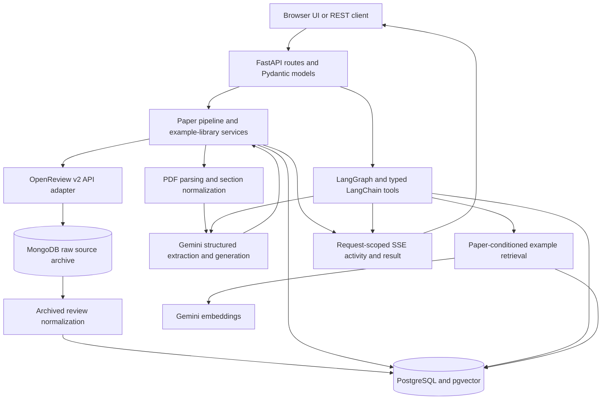

# PaperProbe

**A backend and data integration project for ingesting research papers, preserving source provenance, and generating discussion questions with LLM and agentic workflows.**

## Overview

PaperProbe accepts a PDF upload or public OpenReview forum ID, integrates paper
metadata and reviews, normalizes revision-scoped records into PostgreSQL, and
archives raw OpenReview responses in MongoDB. A FastAPI service exposes ingestion,
retrieval, question generation, and example-library operations through REST
endpoints and a browser interface.

Gemini turns relevant paper sections into structured summaries, claims, methods,
datasets, baselines, and limitations. Readers can use a standard question generator
or a bounded LangGraph workflow that gathers stored context, retrieves similar
paper/question examples, proposes questions, critiques them, and revises or
replaces candidates before saving accepted results. Questions should be specific,
answerable, critical, and closely tied to the paper; they can explore implications,
related work, and open problems grounded in the available context.

The project has two purposes: build a useful tool for critically reading research
papers, and develop a maintainable backend platform around a concrete data and AI
use case. Current work demonstrates service separation, external API integration,
relational and document storage, migrations, typed contracts, and streamed workflow
activity. The engineering direction prioritizes reliability, testing, background
processing, and deployment. Queued jobs, CI/CD, and AWS deployment are planned.

- [Features and technology stack](#features-and-technology-stack)
- [System architecture](#system-architecture)
- [Backend and REST API design](#backend-and-rest-api-design)
- [Data integration and database design](#data-integration-and-database-design)
- [LLM processing and agentic workflow design](#llm-processing-and-agentic-workflow-design)
- [Setup and local development](#setup-and-local-development)
- [Testing and CI/CD](#testing-and-cicd)
- [Deployment and infrastructure](#deployment-and-infrastructure)
- [Engineering roadmap](#engineering-roadmap)
- [License](#license)

### Motivation

I took an LLM-paper seminar class, and whenever I asked an LLM to think of discussion questions based on a paper, it often generated superficial or strange questions. In class, people asked insightful questions, and I learned a lot from seeing how they critiqued papers. I want to help readers develop similarly useful questions grounded in a paper's content. The agentic workflow gathers available context, proposes questions, and uses model critiques to decide whether each candidate is ready, needs revision, or should be replaced.

### Learning goals

1. Design REST APIs and backend service boundaries with FastAPI, typed contracts,
   validation, reusable modules, typing, and version control.
2. Build data ingestion, transformation, normalization, and integration pipelines;
   manage relational PostgreSQL and NoSQL MongoDB schemas, migrations, and provenance.
3. Expand automated tests and introduce continuous integration and delivery.
4. Learn asynchronous processing and background job orchestration with explicit
   job state, retries, timeouts, and recovery.
5. Containerize application services and deploy cloud infrastructure, particularly AWS.
6. Develop logging, monitoring, error handling, and system reliability practices.
7. Integrate LLM APIs with structured outputs, tool use, prompt versioning,
   LangChain/LangGraph orchestration, and evaluation-driven question improvement.

## Features and Technology Stack

Status describes code and configuration in this repository. **Partial** means a
foundation exists with important work still outstanding; **planned** means a
development goal.

| Area | Implemented technology and behavior | Partial or planned work |
| --- | --- | --- |
| Backend/API | Python 3.11+, FastAPI, Uvicorn, Pydantic models/settings; versioned REST routes and service modules | Broader API contracts, consistent errors and API integration tests |
| Relational storage | PostgreSQL, SQLAlchemy async sessions, asyncpg, Alembic migrations; version-scoped records and constraints | Query profiling, further indexing and concurrent-refresh consistency |
| Raw-source storage | MongoDB/PyMongo; hashed, version-tagged OpenReview source snapshots | Cross-store reconciliation and recovery automation |
| Data integration | `openreview-py` v2 client, paginated notes, title/author matching, PDF fallbacks; `pypdf`, section normalization and chunking | Older v1/venue-wide collection, OCR and stronger idempotency |
| LLM processing | Optional `google-genai` client; schema-constrained Gemini extraction and generation; stored `section-v1` extraction provenance | Broader prompt/version evaluation and model comparisons |
| Agent orchestration | Optional `langchain-core` and LangGraph; typed tools, conditional critique/revision/replacement, bounded execution | Additional retrieval and analysis tools after core platform work |
| Retrieval | pgvector; 768-dimensional paper-conditioned example embeddings and cosine ranking | Partial: chunks exist, but chunk embeddings/retrieval are not wired into ingestion |
| Execution/UI | FastAPI-served browser UI, async I/O, thread offloading and request-scoped server-sent events (SSE) | Celery/Redis workers, durable job state and status endpoints |
| Testing/tooling | Initial Pytest suite, HTTPX/TestClient, Ruff dependency/configuration | Broader tests, GitHub Actions and automated LLM evaluation |
| Infrastructure | Docker Compose databases, persistent volumes and database health checks | API/worker images, automated builds/deployment and AWS |
| Operational visibility | Liveness, configuration-only readiness, UI Activity and stream failure events | Structured logs, correlation IDs, metrics, tracing, alerts and error tracking |

## System Architecture

FastAPI owns HTTP validation, dependency injection, responses, and HTTP-specific
error mapping. Pipeline services coordinate source adapters, parsing, Gemini,
and persistence. PostgreSQL holds the queryable application model; MongoDB
preserves source-shaped OpenReview JSON before normalization.



Source identification and raw archiving precede relational ingestion writes.
Sections, structured fields, reviews, and chunks belong to paper versions. The
agent graph starts from a prepared paper and shares these services and persistence
contracts. The example library stores separate paper/question pairs without
creating normal application paper records.

Ingestion runs synchronously from the caller's perspective: a normal request waits
for the pipeline result. Progress endpoints run the same operation inside the
active streaming request, using an in-process task and queue to emit events.
Async database access and `asyncio.to_thread` offloading do not provide durable
background jobs. Closing a progress stream cancels its unfinished task; there is
no persisted job queue or resume mechanism.

### Project structure

```text
app/
  api/routes/          # HTTP endpoints and HTTP-specific error mapping
  api/progress.py      # request-scoped SSE milestones, results and failures
  services/            # ingestion, parsing, extraction, generation and example library
    paper_pipeline.py  # reusable application pipeline and persistence operations
    openreview.py      # external matching, fetching and PDF fallbacks
    openreview_archive.py # raw-source archiving and reads
    agent_tools.py     # typed LangChain adapters
    agent_graph.py     # bounded LangGraph execution and state
    agent_policy.py    # shared limits and workflow prompt
  core/config.py       # environment-based settings
  db/                  # SQLAlchemy models and async session factory
  schemas/             # API and LLM request/response models
  web/                 # browser interface served by FastAPI
  main.py              # FastAPI application factory
alembic/versions/      # ordered schema migrations
scripts/               # database administration and external API smoke check
tests/                 # initial API and OpenReview helper tests
.env.example           # safe configuration template
docker-compose.yml     # local database services only
pyproject.toml         # dependencies, optional extras, Pytest and Ruff settings
```

## Backend and REST API Design

### Routes, models, and service separation

`create_app()` in `app/main.py` registers the router under `API_V1_PREFIX`
(default `/api/v1`), CORS settings, static assets, and the UI. Paper routes
delegate ingestion/generation to `app.services.paper_pipeline`; example routes
use dedicated upload/library services. Read routes also perform SQLAlchemy
lookups and serialization. Database dependencies supply scoped `AsyncSession`
instances; the shared engine uses connection pre-ping and registers pgvector.

Pydantic schemas in `app/schemas/` define UUID identifiers, version summaries,
sections, extracted-field provenance, reviews, and stored questions.
`OpenReviewIngestRequest` requires a nonempty `forum_id`;
`QuestionGenerationRequest.count` defaults to 5 and accepts 3–10. Example-question
create/update models bound text and rationale to 10,000 characters. Upload routes
validate file type/name, the `%PDF` signature, and a 20 MB maximum. An example
upload accepts 1–20 questions with optional rationales and source type
`own_criticism` or `openreview_review`.

All paths below use the default prefix. OpenAPI documentation is available at
`http://127.0.0.1:8000/docs` after startup.

| Method | Path | Behavior / response |
| --- | --- | --- |
| GET | `/api/v1/health` | Liveness: status and configured environment |
| GET | `/api/v1/readiness` | Configuration flags for Gemini, PostgreSQL and MongoDB; does not test connectivity |
| POST | `/api/v1/papers/openreview` | Ingest/refresh a forum and qualifying related forums; `PaperDetail` |
| POST | `/api/v1/papers/upload` | Multipart `file`; ingest matched or local PDF; `PaperDetail` |
| GET | `/api/v1/papers/{paper_id}` | Latest context and retained version summaries; `PaperDetail` |
| GET | `/api/v1/papers/{paper_id}/versions/{version_id}` | Retained version text, sections, fields and reviews; `PaperVersionDetail` |
| POST | `/api/v1/papers/{paper_id}/questions` | JSON `count`; standard generation; `QuestionGenerationResponse` |
| GET | `/api/v1/papers/{paper_id}/questions` | Stored questions, newest first |
| POST | `/api/v1/papers/openreview/progress`, `/api/v1/papers/upload/progress` | Ingestion with SSE activity and result |
| POST | `/api/v1/papers/{paper_id}/questions/progress` | Standard generation with SSE activity |
| POST | `/api/v1/papers/{paper_id}/agentic-questions/progress` | Bounded agent run on a prepared paper; SSE activity and run summary |
| GET | `/api/v1/examples` | Example source papers with associated questions |
| POST | `/api/v1/examples/upload` | Multipart `file`, `source_type`, repeated `questions`, optional `rationales` |
| POST | `/api/v1/examples/papers/{source_paper_id}/questions` | Add a question/rationale to an existing example source |
| PATCH | `/api/v1/examples/questions/{question_id}` | Replace example question text and optional rationale |
| DELETE | `/api/v1/examples/questions/{question_id}` | Delete one example question; 204 |

### Validation, errors, and streaming

Non-streaming ingestion returns 201 for a new paper and 200 for a recognized
refresh. The forum route sets `X-PaperProbe-Cache` to `miss` or `refreshed` based
on its primary-forum lookup; this is not an HTTP response cache.
FastAPI rejects invalid request models/UUIDs with 422. Missing paper/version reads
return 404; oversized PDFs return 413; invalid PDF types/signatures return 415.
Missing OpenReview title/abstract content maps to 422 with `message`,
`missing_fields`, and `available_fields`. Other ingestion/generation failures
are generally mapped to 502; example-library validation/lookup errors map to
422/404. Error envelopes and mappings are not yet uniform.

`app/api/progress.py` sends `text/event-stream` frames as `data: <JSON>` followed
by a blank line. A `step` event contains `id`, `label`, `state`, and `detail`,
with optional diagnostics. Success emits a `result` with the serialized response;
exceptions emit a `failure` with the active step and error detail. Clients must
inspect events for failure because an already-started stream cannot become a
normal HTTP error response. These streams provide UI feedback rather than
durable operational logs or job-status APIs.

### Endpoint examples

After [local setup](#setup-and-local-development), ingest a public forum,
retrieve context and a specific revision, and generate questions:

```powershell
$baseUrl = 'http://127.0.0.1:8000/api/v1'
$paper = Invoke-RestMethod -Method Post -Uri "$baseUrl/papers/openreview" `
  -ContentType 'application/json' `
  -Body '{"forum_id":"<public-openreview-forum-id>"}'
Invoke-RestMethod -Uri "$baseUrl/papers/$($paper.id)"
Invoke-RestMethod -Uri "$baseUrl/papers/$($paper.id)/versions/$($paper.latest_version_id)"
Invoke-RestMethod -Method Post -Uri "$baseUrl/papers/$($paper.id)/questions" `
  -ContentType 'application/json' -Body '{"count":5}'
Invoke-RestMethod -Uri "$baseUrl/papers/$($paper.id)/questions"
```

Use `curl.exe` on Windows for multipart uploads or to inspect streamed events:

```powershell
curl.exe -X POST http://127.0.0.1:8000/api/v1/papers/upload -F 'file=@paper.pdf;type=application/pdf'
'{"count":5}' | curl.exe -N -X POST "http://127.0.0.1:8000/api/v1/papers/$($paper.id)/agentic-questions/progress" `
  -H 'Content-Type: application/json' --data-binary '@-'
```

The ingestion response includes `id`, `latest_version_id`, `versions`, latest
`full_text`, `sections`, `extracted_fields`, and `reviews`. Generation returns
`paper_id` and `questions`; stored questions include their ID, version ID, text,
status, source, critic notes, and creation time. The [agent design](#agentic-workflow-design)
describes the streamed run summary.

## Data Integration and Database Design

### Source integration and retention policy

The implemented adapter uses the official `openreview-py` v2 client for public
forums, with optional credentials for authenticated access. The original design
also considered older v1 venues and venue-wide accepted-paper collection; these
remain extension points. Metadata/reviews are stored for later reads; explicit
re-ingestion refreshes sources rather than serving an immutable offline snapshot.

Raw review text is source data for local processing, not material to commit or
redistribute in bulk. Only derived artifacts such as extracted fields, generated
questions, and aggregate statistics are intended for public sharing.

The retention unit is the newest submission version **per matched forum**, with
one version marked latest across the paper. This supports cross-forum revision
comparison without retaining every historical edit. Refreshes remove superseded
versions for affected forums from both stores.

### Current data pipeline

1. **Receive and identify the paper.** A user can submit a forum ID directly or
   upload a PDF. Upload processing extracts title, likely authors, abstract,
   and complete machine-readable PDF text. When title or abstract layout
   detection fails but readable text exists, the upload is still stored with a
   fallback title and its full text. The OpenReview search keeps the existing
   title/author matching rules: exact normalized title passes; otherwise a title
   match of at least 90% requires at least 30% author similarity. If no forum is
   safely matched, the upload is still stored as a local paper with one version
   keyed by its PDF digest and no OpenReview edit timestamp.
2. **Find related forums and fetch their newest versions.** OpenReview forum IDs are
     not assumed to contain every revision of a paper. PaperProbe searches the
     title index with overlapping title phrases, scores candidate titles and
     authors using the existing rules (exact normalized title, or title similarity
     of at least 90% plus author similarity of at least 30%), and fetches every
     qualifying forum. Each forum's current submission note, newest edit, and
     paginated forum notes are loaded. Only each forum's newest submission edit is retained
     as a revision, identified by its source forum ID, OpenReview edit ID, and
     timestamp. The current submission note is the authoritative content for that
     forum version. Its PDF is downloaded and parsed. For a referenced PDF, the
     downloader tries the PDF field ID and reference routes, OpenReview's
     note-attachment route, and the note-ID PDF route via `openreview-py`
     (`get_pdf(id=pdf_id,
   is_reference=True)`) for revision-specific references. If all fail or the PDF has
   no extractable text, forum-ID ingestion continues with that version's
   available title, abstract, and reviews. Its `paper_text` stays empty and the
   failure is recorded in version metadata. An uploaded PDF is an independent
   text source: its extracted full text is always retained and used for the
   newest matched forum version, even if OpenReview lookup or PDF retrieval
   fails. A lookup failure falls back to storing the upload as a local paper.
   Revision text is not collapsed into one forum-level field.
3. **Archive raw data first.** The latest submission edit and all review-note
   JSON for each matched forum are written to MongoDB with forum and version
   identifiers. Since only the latest version per forum is retained, all reviews
   from that forum are associated with that version. When a forum is refreshed,
   obsolete raw snapshots for its older submission versions are removed.
4. **Normalize into PostgreSQL.** `papers` has one row per paper identity (or a
   local upload without an OpenReview match), even when that identity spans
   multiple forum IDs. `paper_versions` stores one row per revision, with version
   key, timestamp, `is_latest`, title, authors, abstract, and complete `paper_text`.
   `source_forum_id` records which OpenReview forum supplied each revision, and
   the version key combines forum ID and edit ID so IDs from separate forums
   cannot collide. The paper root records all matched forum IDs in metadata.
   Re-ingesting any matched forum refreshes each qualifying forum's latest version
   and reviews, and removes older relational versions for those forums.
5. **Parse and store named sections.** Each version's readable full text is
   first cleaned of repeated three/four-digit line-number gutters when those
   labels form a clear sequence. Then it is split at recognized standalone
   headers such as Abstract, Introduction,
   Related Work, Method, Experiments, Limitations, Discussion, and Conclusion.
   Header matching is heuristic; unrecognized text is retained in a `Full Text`
   section, and OpenReview's abstract is added when the PDF has no Abstract
   heading. The resulting `paper_sections` rows retain the heading, order, and
   section text. They do not currently store source character offsets or page
   ranges.
6. **Extract fields by section.** Only the latest revision is sent to Gemini for
   structured extraction. PaperProbe makes one focused call for each section
   assigned fields, rather than sending the whole paper in one request. Summary
   and claims are sought in Abstract/Introduction; methods in Method; datasets
   and baselines in Experiments; limitations in Limitations, Conclusion, or
   Discussion. If a preferred section is missing, its fields fall back to the
   available section text. Each result is saved in `extracted_fields` with a
   `section_id` foreign key, plus the Gemini model and `section-v1` prompt
   version; API responses resolve the section ID to its heading. Multiple rows
   of the same field type can preserve results from different source sections.
   `reviews` stores review text read back from MongoDB, along with raw content and OpenReview note
   metadata; every review row references the assigned version. Revision authors,
   sections, text, chunks, and review notes are version-scoped as well. Questions also retain
   their version link.
7. **Prepare full text for retrieval.** Every version's `paper_text` is split
   into overlapping chunks in `paper_chunks` (about 3,000 characters per chunk
   with a 300-character overlap, preferring nearby paragraph/sentence boundaries).
   The table has a pgvector `embedding vector(768)` column and an embedding-model
   field. Chunk records are currently populated, while token counts and embeddings
   are left null until a dedicated chunk-embedding job is wired into ingestion.
   This keeps the database ready for chunk retrieval without fabricating vectors;
   example-pair embeddings are stored separately for paper-conditioned retrieval.
8. **Generate questions.** The question endpoint uses the latest version's
   abstract and merged extracted fields, which are now derived from relevant
   full-text sections. If forum-ID PDF retrieval fails, extraction falls back to
   the available abstract or other parsed section text. Generated questions
   store both the forum-level paper ID and the exact version ID that supplied
   the context. The versioned body, reviews, and chunks remain available for
   future retrieval-based generation.

Uploaded PDFs and PDFs fetched from OpenReview both populate
`paper_versions.paper_text`. PDF extraction reads embedded text; scanned pages
that need OCR are not currently recognized. MongoDB preserves source-shaped
OpenReview JSON for future extraction, while PostgreSQL stores one latest version
per matched forum with its version-linked text, review records, structured fields,
and retrieval chunks.

### Paper matching details

1. PaperProbe extracts the PDF title, abstract, and likely author names from the
   first-page author block and computes a SHA-256 PDF digest for stored source
   identity. The PDF abstract is retained for local processing but does not rank
   OpenReview matches.
2. It searches OpenReview's title index using the full title and up to eight short,
   overlapping phrases sampled across the title. Results from these searches are
   combined by forum ID. Every forum that passes the matching rules contributes
   only its latest submission version and its reviews, stored together under one
   paper record with each version retaining its source forum ID.
3. Titles are normalized for case, Unicode accents, punctuation, whitespace, and
   line-wrap hyphenation, then scored using character-sequence similarity and
   title-word overlap. A title score of at least 90% is required; an exact
   normalized title scores 100% and always passes the title gate. For a non-exact
   title, author-list similarity must also be at least 30%. This lower author
   threshold allows a partial author extraction to contribute evidence; an exact
   title can still match when author extraction is incomplete or unavailable. The
   uploaded abstract is not used to rank or approve candidates.
4. Each qualifying forum contributes only its newest edit. These per-forum
   versions are ordered by timestamp, and the newest overall becomes the current
   version for section-scoped Gemini extraction. If no candidate qualifies, it
   uses the uploaded PDF's title and abstract.

### MongoDB raw-source archive

MongoDB retains the original OpenReview API documents before they are normalized.
Each retained document has `forum_id`, `version_id`, `version_timestamp`, `note_id`,
`record_type` (`submission_edit`, `submission_note`, or `review`), fetch time,
and a payload hash. The archive key includes forum, version, record type, note,
and content hash, so edits do not overwrite each other and changed note payloads
remain recoverable for the retained current version. Review documents also carry
the version assignment used by the relational layer. Refreshing a forum removes
raw documents tagged to its superseded submission versions.

```powershell
docker compose exec mongodb mongosh paperprobe --eval 'db.openreview_raw_notes.countDocuments()'
```

Use `app.services.openreview_archive.load_archived_openreview_notes(forum_id,
version_id)` to read the preserved source records. MongoDB is the raw source
snapshot; PostgreSQL is the queryable application model.

### Relational schema, migrations, and provenance

The ORM schema lives in [app/db/models.py](app/db/models.py); ordered changes are
in [alembic/versions](alembic/versions).

| Table | Purpose and relationships |
| --- | --- |
| `papers` | Root identity, source URI/type, primary forum ID, status, JSONB metadata including related forum IDs and PDF digest |
| `paper_versions` | Revision text, title, authors, abstract, source forum, version key/timestamp, `is_latest`; paper FK |
| `paper_sections` | Ordered named content; paper/version FKs; unique position per version |
| `extracted_fields` | JSONB values, model/prompt version; version FK and nullable section FK for provenance |
| `reviews` | Normalized text plus raw content/note metadata; version FK; unique note ID per version |
| `paper_chunks` | Overlapping text, nullable token/embedding/model fields; version FK; unique chunk index per version |
| `questions` | Paper/version FKs, optional section FK, text, status/source, critic notes and optional rating |
| `example_pairs` | Independent source-paper context, question/rationale, source type, embedding/model and shared `source_paper_id` |

`papers.forum_id` and `source_uri` are unique. Versions have a unique
`(paper_id, version_key)` constraint and partial unique index allowing at most
one `is_latest=true` row per paper. Review/chunk version indexes, the field-section
index, and example source indexes support lookups. Foreign keys cascade deletions
through version-owned records; optional section references use `SET NULL`.
Example source types have a database check constraint.

Alembic evolves the schema through full text, revision-scoped records,
section-extraction indexing, version authors/source forums, and grouped example
pairs. The versioning migration backfills a `legacy` version and enables `vector`.
Apply upgrades during [database initialization](#start-databases-and-apply-migrations);
`create_all` is not the documented schema-upgrade path.

### Consistency and recovery boundaries

MongoDB uses deterministic IDs based on forum, version, record type, note ID,
and payload hash, with insert-only upserts for repeated payloads. PostgreSQL
identifies existing sources/version keys, replaces derived sections/reviews/chunks
on refresh, and commits the relational update together. Questions on retained
versions become `stale`; questions attached to deleted versions are removed by
cascade. Generated artifacts keep explicit version links.

Raw archiving precedes relational persistence in a separate store. There is no
distributed transaction: later extraction/SQL failure can leave archived sources
without a completed relational refresh. Hashes, constraints and archive-first
processing are consistency foundations, not an exactly-once guarantee. Refreshes
can replace row IDs and repeat Gemini calls. Concurrent ingestion, idempotency
keys, cross-store reconciliation, and recovery automation remain engineering work.

A failed archive blocks forum ingestion. Upload processing catches OpenReview
lookup failures and can continue as a local paper using its own text. Metadata
records PDF errors and text origin; extracted fields record section, model, and
prompt version, making incomplete source integration visible.

## LLM Processing and Agentic Workflow Design

### Structured extraction and standard generation

Gemini is called once per relevant parsed section with a schema containing only
that section's fields. Dynamic Pydantic schemas and JSON responses validate
summaries, claims with supporting section paraphrases, methods, datasets,
baselines, and limitations. Unsupported values should be empty. Section routing
and fallback rules are detailed in the [data pipeline](#current-data-pipeline).

Extraction stores the Gemini model and `section-v1` prompt version per field so
changes can be compared. A full evaluation system is planned. Generation and
critique also use structured outputs but do not currently persist separate prompt
versions per run.

The standard `generate_and_store_questions` path merges the latest section-derived
fields with title/abstract, calls Gemini, checks the requested count, and stores
`draft` questions with source `gemini`, focus and rationale. It does not run the
agent critique loop. Its service generator accepts full text, while the current
standard endpoint passes title, abstract, and merged fields. The agent path also
supplies full text, all retained review context, and retrieved examples.

### Agentic workflow design

This section documents the implemented agent path and the boundaries that keep
it extensible. The standard UI pipeline remains available; the agentic run is a
separate action on a prepared paper.

#### Current design

Pipeline operations live in `app.services.paper_pipeline`, independently of the
FastAPI route handlers. The current UI prepares papers through its existing
ingestion/parsing flow. The agent toolset reads that prepared context, extracts
fields only when needed, proposes and critiques questions, then saves the final
question list.

LangChain adapters live in `app.services.agent_tools`; the graph is in
`app.services.agent_graph`. Install the optional dependencies with
`pip install -e ".[agent,gemini,openreview]"`. `create_paper_tools(session_factory)`
combines pure and database-backed tools without exposing a session or database
credentials as model arguments. Each adapter has a descriptive name, a clear
tool description, an explicit Pydantic input schema, and a typed output model;
`PAPER_TOOL_OUTPUT_SCHEMAS` exposes output models by tool name. The LangGraph
invokes these tools from bounded nodes and passes the workflow system prompt to
the generation and critique models.

| Tool/service | Input | Output | Side effects |
| --- | --- | --- | --- |
| `get_stored_paper(db, paper_id)` | Session and prepared paper UUID | `PaperDetail` with latest text, sections, and existing extracted fields | Read-only database lookup. |
| `get_all_reviews_for_paper(db, paper_id)` | Session and prepared paper UUID | All stored reviews tagged with version key, source forum, and paper title | Read-only lookup across every stored version, not only the latest. |
| `retrieve_similar_example_questions(db, paper_context, k)` | Session, target paper abstract/claims, and result count | `SimilarExampleQuestions` paper/question pairs with source and similarity | Embeds target paper context and searches `example_pairs.paper_embedding`; read-only. |
| `extract_paper_fields` agent adapter | Title, full text, optional abstract fallback | Section-level fields and merged values | Parses sections internally, calls Gemini; no database writes. |
| `propose_questions(...)` | Paper context, all-version reviews, similar-paper examples, and count | `QuestionGeneration` proposals with focus and rationale | Gemini call; no database writes. |
| `critique_question(...)` | Candidate question, paper context, and all-version review context | `QuestionCritique` verdict, rubric scores, strengths/issues, optional revision | Gemini call; no database writes. |
| `save_final_questions(db, paper_id, questions)` | Session, paper UUID, final questions paired with critique results | `QuestionGenerationResponse` | Saves questions with `keep` verdicts as final, linked to the latest paper version; stores focus, rationale, and critique details. |

#### Graph flow and model decisions

The UI exposes **Run agentic workflow** after a paper has been prepared. It
starts `POST /api/v1/papers/{paper_id}/agentic-questions/progress` and streams
graph milestones into the existing Activity panel. The run starts with the
selected paper ID, a generated system prompt containing the question goal and
hard limits, and the available tool set.

The graph fixes operation order and safety limits while leaving quality
judgments to Gemini's structured outputs:

1. **Gather context:** `get_stored_paper` loads the latest prepared paper.
   `get_all_reviews_for_paper` adds reviews across every retained version. The
   graph reuses stored extracted fields, calling `extract_paper_fields` only
   when fields are absent. It also retrieves paper-conditioned examples; if
   example retrieval fails, the run can continue without examples.
2. **Generate:** `propose_questions` returns structured candidate questions,
   focus labels, and rationales using the paper, extracted fields, all-version
   reviews, similar-paper examples, and workflow system prompt.
3. **Critique:** `critique_question` scores each candidate and returns a
   model-generated `keep`, `revise`, or `reject` verdict plus an optional
   revision. A conditional graph edge reads this verdict: `keep` accepts the
   candidate; `revise` uses the model's suggested text and sends it back for
   critique; `reject` drops it.
4. **Replace or finalize:** Dropped candidates are replaced through the generate
   node when more questions are needed and budget remains. When the requested
   count is accepted or the budget is exhausted, the graph calls
   `save_final_questions` once for accepted questions. It saves nothing when no
   candidate passes critique.

There are at most two revisions (three critique calls) per candidate and 40
tool calls per run, including the terminal save. The graph reserves the final
call for saving accepted questions. Reaching the requested count ends the run
early. There is no human approval step. The UI displays context gathering,
extraction/example retrieval, proposal rounds, each critique verdict, revisions,
and final persistence in the Activity panel.

Ingestion, upload, and paper parsing remain UI-triggered preparation steps.
They are not available to the graph, which starts only after the UI has a
stored paper. The standard `generate_questions_from_context` and
`generate_and_store_questions` path remains the non-agentic fallback and is not
exposed as an agent tool.

`propose_questions` and `critique_question` are standalone functions in
`app.services.gemini`, with validated Pydantic output models. The proposal
operation returns question/focus/rationale records. The critique operation
assesses specificity, grounding, answerability, and critical value, and returns
a keep/revise/reject decision. The non-agentic application fallback remains
available through the `generate_questions_from_context` and
`generate_and_store_questions` services and the existing question-generation
route; neither is exported as an agent tool, avoiding overlapping generation
choices in the agent tool list.

#### Execution state and persistence boundaries

`AgentState` is a `TypedDict` carrying paper/context, target count, system prompt,
fields, reviews, examples, candidate queue, current critique, accepted questions,
revision/proposal counters, tool-call count, and saved response. Nodes return
state updates; conditional edges read verdicts and counters. The compiled graph
runs with `ainvoke` in the active HTTP operation. State is in memory; no durable
checkpoint, resume API, or worker queue is configured.

Database-backed adapters acquire sessions from the supplied factory. The
`extract_paper_fields` adapter accepts title/full text/optional abstract, parses
sections, and delegates to the pipeline service `extract_paper_fields(title, sections)`.
Fallback extraction supplies graph context without persisting replacement field
rows. Terminal persistence validates every `keep` verdict, then commits `final`
questions with source `agent` and focus/rationale/critique JSON in `critic_notes`.
The save resolves the latest version at that time; pinning a run's starting
version against concurrent refreshes remains consistency work.

The result includes `requested_count`, `saved_count`, `tool_calls`, `questions`,
and `outcome`: `target_met`, `saved_partial_result`, or `no_questions_passed`.
The budget can yield fewer accepted questions than requested; none passing means
no database save.

#### Extending the workflow

The LangGraph owns ordering, branching, and bounded retries. Keep tools focused
on one operation, with outputs that give graph nodes the information they need:

- Give each new tool an explicit Pydantic input and output model, a concise
  description that says when it is useful, and a clear statement of database or
  external-service side effects.
- Keep orchestration state separate from tool code. Carry the paper and version
  IDs, source provenance, existing extracted fields, all-version review context,
  retrieved paper/question pairs, candidate questions, critique results,
  per-question revision counts, and the run-wide tool-call count between graph steps.
- Keep context-dependent decisions in the graph. A tool should perform its
  named operation and return structured results rather than silently launching
  the rest of the pipeline.
- Add retrieval, model alternatives, or additional reviewer tools as separate
  capabilities so future workflows can opt into them per paper.
- Version prompts and keep proposal/critique outputs structured so workflow
  changes can be compared with evaluation data.
- Keep stopping limits in graph state and the system prompt: at
  most two revisions (three critique calls) per question and at most 40 tool
  calls per run, including the final save. Reserve a tool call for
  `save_final_questions` once any candidates are ready.

`app.services.agent_policy` defines these limits and builds the prompt with the
run goal, graph contract, revision policy, and terminal-save conditions. The
workflow graph maintains counters and enforces the same limits rather than
relying on the prompt alone.

The `example_pairs` table stores each example question with its source paper's
title and representative abstract/claims, a 768-dimensional paper embedding,
optional rationale, and source type (`own_criticism` or `openreview_review`).
`retrieve_similar_example_questions` embeds the current paper's abstract and
available claims with the configured Gemini embedding model, then ranks stored
examples by cosine similarity between paper embeddings. It returns the source
paper and its paired question together; question text is not used as the search
vector. Populate `paper_embedding` with the same embedding model named in
`embedding_model` for each row. The separate example-library UI flow accepts a
PDF and multiple questions, extracts the source title and abstract (or readable
text when no abstract is found), embeds the source once, and stores one paired
row per question. Retrieval filters to the configured embedding model and
returns an empty list until matching examples are stored.

#### Incremental development

Future AI extensions can add related-work retrieval, citation lookup, and other
paper-analysis tools in small, evaluated steps. These remain separate from the
core engineering priorities of API reliability, data consistency, testing,
background processing, and deployment. Workflow execution does not require
human approval or collect user edits as training data.

The current UI ingestion convenience operations still run parsing and
extraction as part of the existing prepare-paper flow. If a future agent needs
to handle an under-prepared paper, add a source-only ingestion operation and
compose parsing and extraction explicitly; keep the UI path as it is today.

## Setup and Local Development

Requires Python 3.11 or later. Create a virtual environment, install the API,
development, OpenReview, and Gemini dependencies, then create local configuration:

```powershell
python -m venv .venv
.\.venv\Scripts\Activate.ps1
pip install -e ".[dev,openreview,gemini]"
copy .env.example .env
```

The `.env` file is git-ignored; `.env.example` documents expected settings without
containing secrets.
Set `GEMINI_API_KEY` in `.env`. Set `POSTGRES_DSN` for PostgreSQL and
`MONGODB_URI`, `MONGODB_DATABASE`, and `MONGODB_RAW_COLLECTION` for MongoDB.
MongoDB is required for any OpenReview ingestion: the app stops that ingestion if
the raw API notes cannot be archived, rather than continue with an incomplete
source record. PDF-only processing can still use the uploaded document when no
OpenReview match is found. Do not store credentials in committed files.

### Start databases and apply migrations

Docker Compose starts PostgreSQL with pgvector support and MongoDB; the API
runs separately on the host. Configure `.env` from
`.env.example`, including the PostgreSQL DSN, MongoDB settings, and Gemini API
key, then run:

```powershell
docker compose up -d postgres mongodb
.\.venv\Scripts\alembic upgrade head
docker compose exec postgres psql -U paperprobe -d paperprobe -c "\dt"
```

Alembic creates the forum/revision tables and enables the PostgreSQL `vector`
extension. Existing pre-versioning rows are migrated into one `legacy` paper
version, including their abstract and any saved full text. New schema changes
should be added as migrations and applied with `alembic upgrade head`.
The section-extraction migration indexes the existing `extracted_fields.section_id`
relationship. Existing stored papers are not automatically re-extracted; submit
their forum IDs again or upload them again to parse sections and populate field provenance.

### Configuration reference

Settings load from `.env` and process environment through Pydantic Settings.
Use [.env.example](.env.example) as the local template.

| Settings | Use |
| --- | --- |
| `APP_NAME`, `ENVIRONMENT`, `DEBUG`, `API_V1_PREFIX` | Application identity, environment, debug mode and route prefix |
| `CORS_ORIGINS` | Comma-separated allowed browser origins |
| `GEMINI_API_KEY`, `GEMINI_MODEL` | Extraction, generation, proposals and critique |
| `GEMINI_EMBEDDING_MODEL` | Optional embedding-model override; code default is `gemini-embedding-001` |
| `POSTGRES_DSN` | Async SQLAlchemy connection URL; local example uses host port 5433 |
| `POSTGRES_USER`, `POSTGRES_PASSWORD`, `POSTGRES_DATABASE`, `POSTGRES_PORT` | Compose PostgreSQL credentials, database and host port |
| `MONGODB_URI`, `MONGODB_DATABASE`, `MONGODB_RAW_COLLECTION`, `MONGODB_PORT` | Raw archive destination and Compose host port |
| `OPENREVIEW_USERNAME`, `OPENREVIEW_PASSWORD` | Optional paired credentials |
| `OPENREVIEW_FORUM_ID` | Public forum for the standalone smoke script |

`GEMINI_MODEL` in `.env.example` differs from the `Settings` fallback; choose an
available model for your key explicitly. Retrieval filters by embedding model,
so keep stored and query models aligned. For agent support, also install:

```powershell
pip install -e ".[agent,gemini,openreview]"
```

### Application startup

```powershell
uvicorn app.main:app --reload
```

Open `http://127.0.0.1:8000/docs` for the generated interactive API docs. For a
first end-to-end ingestion, after setting `GEMINI_API_KEY`:

```powershell
Invoke-RestMethod -Method Post -Uri http://127.0.0.1:8000/api/v1/papers/openreview `
  -ContentType "application/json" `
  -Body '{"forum_id":"<public-openreview-forum-id>"}'
```

The response contains the persisted paper ID. Retrieve the latest
revision with `GET /api/v1/papers/{paper_id}` or a particular revision, including
its full text, extracted fields, and reviews, with
`GET /api/v1/papers/{paper_id}/versions/{version_id}`.

Submitting a forum ID fetches its newest version, searches for other forums using
the same title/author rules, and combines the newest version and reviews from each
qualifying forum. Re-ingestion refreshes those versions and re-runs extraction on
the newest one overall.

### Browser interface and example library

Open `http://127.0.0.1:8000/` for the browser interface. Enter a forum ID or upload
a text-based PDF (up to 20 MB). Uploads are searched against OpenReview using the
extracted title and likely author names. A match stores the newest version from
each qualifying forum under one paper record; otherwise, the PDF is stored as a
one-version local paper.
After ingestion, use the revision selector to inspect each revision's source forum,
title, authors, parsed sections, extracted fields, and reviews. Review text is expandable
and the selected version key, timestamp, and review count stay visible in the UI.

Use the separate **Add a paper and its questions** panel to add examples for
future agent runs. Upload a PDF, choose whether its questions are your own
criticism or from an OpenReview review, then add one or more question/rationale
pairs. This saves the example pairs without adding the source PDF to the regular
paper library. The **Saved papers and questions** list in the same panel lets you
read each stored paper context and its questions, edit question text or rationale,
remove individual questions, and add questions to a paper already in the library.
These normal example-library changes can all be made in the UI; the database CLI
remains available for broader inspection and administration.

Both matched and PDF-only papers continue through the same Gemini extraction and
question-generation flow. The UI renders extracted fields as cards and lets you
generate five questions from the stored context. Its live Activity log reports PDF
extraction, OpenReview matching, Gemini extraction, database saves, and question
generation. Forum ingestion reports whether a paper was already stored and then
refreshes its revision/review history. Upload activity shows the extracted title
and authors and reports the best candidate title and score when matching fails.

### Local database administration

Use the local CLI to inspect stored records. The reconciliation command is also
shown below, with its current limitation explained after the examples:

```powershell
.\.venv\Scripts\python.exe scripts\db_admin.py status
.\.venv\Scripts\python.exe scripts\db_admin.py list
.\.venv\Scripts\python.exe scripts\db_admin.py show '<paper-id>'
.\.venv\Scripts\python.exe scripts\db_admin.py reconcile '<paper-id>'
.\.venv\Scripts\python.exe scripts\db_admin.py examples list
.\.venv\Scripts\python.exe scripts\db_admin.py examples show '<source-paper-id>'
.\.venv\Scripts\python.exe scripts\db_admin.py rows example_pairs --limit 50
```

**Current limitation:** `reconcile` imports `_ingest_forum` from the route module,
but that symbol is no longer exported after service separation. The command needs
repair before use. Re-submit a forum through the UI/API to refresh an existing
forum-linked paper; merging an unmatched local upload still needs reconciliation.

The intended `reconcile` flow uses the stored forum ID when present. Otherwise it searches by the
stored title; provide `--forum-id <forum-id>` when the title search is poor or
ambiguous. It asks for confirmation, then refreshes all versions and reviews.
Questions on retained versions are kept but marked `stale` because the latest
paper context may have changed; deleting a superseded version cascades to its
linked questions. Gemini must be configured for refreshed extraction.

The CLI's `status` command counts every table registered in the application
schema, including newly added tables. `rows <table>` inspects records from any
mapped table (embedding values are summarized by dimension); pass `--record-id`
to inspect one row. `delete-row <table> <record-id>` removes one row after an
explicit confirmation and follows database cascade rules.

Use `examples list [--query TEXT] [--source-type own_criticism|openreview_review]`
to find uploaded source papers, `examples show <source-paper-id>` to inspect its
paper context and all associated questions, and
`examples delete <source-paper-id>` to remove that source and its question pairs. The CLI also
supports `delete <paper-id>` and `reset`; destructive operations require typing
an explicit confirmation phrase. Deleting a normal paper cascades through its
version-level records. Reset clears every mapped PaperProbe table, including
example pairs, while preserving PostgreSQL itself and the Alembic schema.

## Testing and CI/CD

### Implemented checks

The initial Pytest suite contains three tests in two files:

- `tests/test_health.py` checks liveness through FastAPI `TestClient`.
- `tests/test_openreview_service.py` checks plain/wrapped content fields and
  stable forum source URIs.

After installing the `dev` extra, run:

```powershell
pytest
```

Ruff is included/configured in `pyproject.toml` and can be run with `ruff check .`;
its presence does not establish enforced or passing lint checks. The current
suite has no automated database, ingestion, migration, agent-routing, or external
API integration tests.

### External API smoke test

The standalone smoke test fetches one public OpenReview forum and prints its
submission, abstract, and first review. With `--run-gemini`, it sends only the
title and abstract to Gemini as a lightweight connectivity/schema check; it does
not exercise the FastAPI pipeline's section parser or section-scoped extraction.
It does not call the FastAPI server, write to PostgreSQL, or persist source text.

Set a public forum ID in `.env` as `OPENREVIEW_FORUM_ID`, install the optional
clients, and run it:

```powershell
.\.venv\Scripts\python.exe -m pip install -e ".[openreview,gemini]"
.\.venv\Scripts\python.exe scripts\smoke_external_apis.py
.\.venv\Scripts\python.exe scripts\smoke_external_apis.py --run-gemini
```

Alternatively, pass an ID for a one-off fetch:

```powershell
.\.venv\Scripts\python.exe scripts\smoke_external_apis.py --forum-id '<public-forum-id>'
```

### Planned CI/CD architecture

No GitHub Actions workflow is present. The intended pipeline installs the project
and development extras on pull requests, runs Ruff/Pytest, and adds PostgreSQL/
pgvector and MongoDB service containers for migration/integration tests. Routine
CI should mock external APIs/models; credentialed connectivity checks run separately.

After application containerization, build/test a Docker image, publish versioned
release images, and automate deployment with an explicit migration step and smoke
checks. Promotion and rollback should use the tested image and preserve migration
compatibility. These are planned steps, not an existing delivery pipeline.

## Deployment and Infrastructure

### Current local deployment

[docker-compose.yml](docker-compose.yml) runs `pgvector/pgvector:pg16` and
`mongo:7` with `postgres_data`/`mongodb_data` named volumes. Default host ports
are 5433 and 27017. Container checks use `pg_isready` and `mongosh` ping.
FastAPI runs on the host with Uvicorn and calls OpenReview/Gemini over the network.

There is no application Dockerfile, API/worker Compose service, deployed AWS
configuration, or infrastructure-as-code definition. Liveness, configuration
flags, container health checks and UI Activity provide limited local feedback;
production logging, metrics, tracing and alerting remain planned.

### Future AWS deployment plan (not implemented)

| Component | Planned role |
| --- | --- |
| ECS/Fargate | Containerize API and future Celery workers, then run them as separate services. See [ECS on Fargate](https://docs.aws.amazon.com/AmazonECS/latest/developerguide/AWS_Fargate.html). |
| S3 | Store source/uploaded PDFs and derived artifacts with durable keys/hashes; ingestion needs an object-storage adapter first. See [S3 object storage](https://docs.aws.amazon.com/AmazonS3/latest/userguide/Welcome.html). |
| RDS for PostgreSQL | Host relational data; validate pgvector availability for the chosen engine, apply Alembic, and plan backups/restores. See [RDS for PostgreSQL](https://docs.aws.amazon.com/AmazonRDS/latest/UserGuide/CHAP_PostgreSQL.html). |
| MongoDB | Select hosted MongoDB and validate archive indexes, retention and recovery; S3/RDS do not automatically replace its contract. |
| Redis/Celery | Add queue-backed processing, then choose hosting and persistence/availability settings. |
| IAM and Secrets Manager | Separate execution/application permissions, scope resource access, and supply credentials outside committed config. See [task IAM roles](https://docs.aws.amazon.com/AmazonECS/latest/developerguide/task-iam-roles.html) and [ECS secret injection](https://docs.aws.amazon.com/AmazonECS/latest/developerguide/secrets-envvar-secrets-manager.html). |
| CloudWatch | Centralize container output, then add pipeline/job metrics, dashboards and alerts. See [ECS CloudWatch logging](https://docs.aws.amazon.com/AmazonECS/latest/developerguide/using_awslogs.html). |

Before deployment, add application images, object persistence, connectivity-based
readiness checks, and deployment configuration. Design private database access,
outbound OpenReview/Gemini connectivity, an HTTPS entry point, resource limits,
backup/restore checks, and staged migration/rollback procedures.

## Engineering Roadmap

The priority is a reliable backend and data integration platform. AI extensions
remain a separate development area after the platform foundations.

**Status key:** `[x]` = implemented; `[ ] Partial` = foundation exists with the
listed gaps; `[ ] Planned` = future work. Checked items describe bounded current
behavior, not production readiness.

### REST API Development

- [x] FastAPI routes, scoped sessions, Pydantic request/response models, UUID/count
  validation and PDF checks.
- [ ] **Partial:** Request/response validation and API contracts; standardize error
  envelopes and test streaming failure semantics.
- [ ] **Partial:** Error handling/API reliability; extend source fallbacks and HTTP
  mappings with consistent failure policies.
- [ ] **Planned:** API integration tests for ingestion, retrieval, generation,
  uploads, example-library changes and error responses.

### Database and Data Integration

- [x] PostgreSQL models, MongoDB raw archive, Alembic migrations, source matching,
  version links and section/model/prompt provenance.
- [ ] **Partial:** PostgreSQL query optimization and indexing; profile workloads,
  inspect query plans and add measured indexes.
- [ ] **Partial:** Migrations/schema management; automate upgrade/backfill tests
  and deployment-compatible schema changes.
- [ ] **Partial:** Data validation, normalization, provenance and consistency;
  add cross-store integrity checks and concurrent-refresh/version-pinning guarantees.
- [ ] **Partial:** Idempotent ingestion/source reconciliation; repair the CLI's
  stale route import, then extend hashes, version keys and upserts with concurrency
  controls, repeatable ingestion contracts and partial-failure recovery.

### Asynchronous Processing

- [ ] **Planned:** Celery/Redis task queues for ingestion, extraction, embeddings
  and long-running generation.
- [ ] **Planned:** Durable job state and status endpoints independent of SSE requests.
- [ ] **Partial:** Retries, timeouts and failure recovery; extend existing HTTP/
  MongoDB timeouts, PDF fallbacks and graph limits with coordinated backoff,
  cancellation policies and restart recovery.

### Testing and CI/CD

- [x] Initial Pytest liveness/helper tests and local Ruff configuration.
- [ ] **Partial:** Unit/integration testing with Pytest; cover parsing, matching,
  persistence, migrations, source failures and graph decisions.
- [ ] **Planned:** GitHub Actions testing/linting with isolated database services
  and mocked external calls.
- [ ] **Planned:** Automated Docker image builds and release publishing.
- [ ] **Planned:** Deployment automation with migration, smoke-check and rollback steps.

### Cloud Deployment

- [x] Local database containers, persistent volumes and database health checks.
- [ ] **Planned:** Containerized API/worker deployment.
- [ ] **Planned:** AWS S3 object storage for PDFs and derived artifacts.
- [ ] **Planned:** AWS ECS/Fargate backend services and workers.
- [ ] **Planned:** AWS RDS for PostgreSQL, migrations and backup/restore procedures.
- [ ] **Planned:** Hosted MongoDB/Redis choices and recovery procedures.
- [ ] **Planned:** IAM, secrets management, networking and CloudWatch integration.

### Observability and Reliability

- [x] Liveness, configuration-only readiness and UI activity/failure events.
- [ ] **Planned:** Structured logging with source/version/error context.
- [ ] **Planned:** Request/job correlation IDs across API, workers and model calls.
- [ ] **Planned:** Pipeline metrics and performance monitoring for latency,
  throughput, failures, model usage and queue depth.
- [ ] **Planned:** Alerting, error tracking, tracing and dependency probes.

### AI and Agentic Enhancements

- [x] Section-scoped extraction, structured proposals/critiques, typed LangChain
  tools, bounded LangGraph routing and paper-conditioned example retrieval.
- [ ] **Partial:** Populate chunk embeddings and integrate full-text chunk
  retrieval with embedding-model compatibility and version provenance.
- [ ] **Planned:** Related-work retrieval, citation lookup, model alternatives,
  reviewer/analysis tools and source-only ingestion for future graph preparation.
- [ ] **Planned:** Embedding-similarity evaluation, LLM-as-judge rubrics and offline
  human ratings to improve question quality and catch regressions.
- [ ] **Partial:** Extend prompt versioning and output comparison across extraction,
  proposal and critique while keeping tool contracts, state and limits explicit.

## License

Code in this repository is licensed under MIT (see [LICENSE](LICENSE)). OpenReview-derived source data is not redistributed in bulk from this repository; raw review text is retained locally for processing only.
