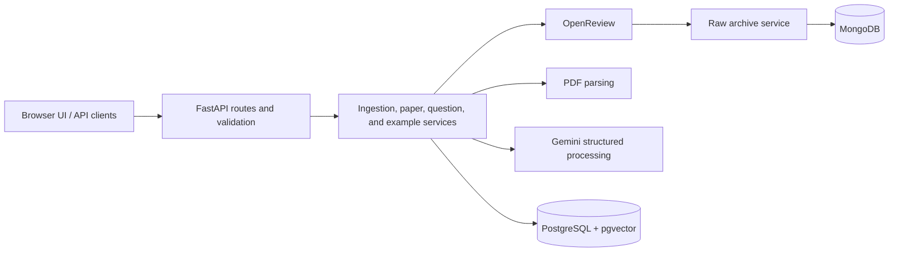
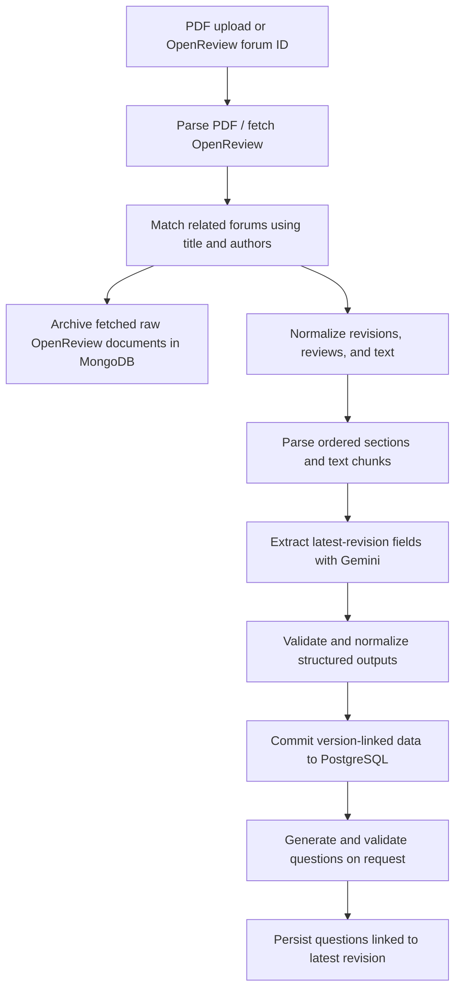

# PaperProbe

## Overview

PaperProbe ingests research papers from PDFs and OpenReview, preserves revision and review provenance, and uses Gemini to extract structured fields and generate discussion questions. It grew out of a paper seminar where useful discussion required questions grounded in the paper’s evidence.

The project focuses on maintainable REST services, data ingestion and transformation, and PostgreSQL/MongoDB integration. Application code controls pipeline execution; LLMs perform defined processing tasks.

## Features and Tech Stack

| Implemented capability | Technologies |
| --- | --- |
| Validated REST API, interactive API docs, and a small browser UI | FastAPI, Pydantic, HTML/CSS/JavaScript |
| PDF parsing, OpenReview matching, revision and review ingestion | pypdf, OpenReview Python client |
| Structured section extraction and discussion questions | Gemini, Pydantic output validation |
| Normalized paper data, version-linked results, and migrations | PostgreSQL, SQLAlchemy async, asyncpg, Alembic |
| Raw source archival and provenance | MongoDB, PyMongo |
| Editable paper/question example library and reusable similarity retrieval | Gemini embeddings, pgvector |
| Unit and API tests, linting | pytest, HTTPX, Ruff |

Database integration tests, CI/CD, background processing, deployment, and observability remain future improvements.

## System Architecture



Routes validate requests and map failures to API responses. Services coordinate parsing, normalization, LLM calls, and persistence. Gemini supplies structured content; PostgreSQL serves application data, while MongoDB retains source payloads.

```text
app/
  api/              # Routes and server-sent progress events
  core/config.py    # Environment settings
  db/               # SQLAlchemy models and async sessions
  schemas/          # Request, response, and LLM contracts
  services/         # Paper pipeline, parsing, Gemini, archive, example library/retrieval
  web/              # Browser interface
alembic/            # PostgreSQL schema migrations
scripts/            # Database administration and external API smoke checks
tests/              # Automated tests
```

## Data Pipeline and Database Design



1. Accept a PDF of up to 20 MB or a public OpenReview forum ID. PDF uploads continue locally if OpenReview matching fails.
2. Fetch matching forum revisions and reviews; archive raw OpenReview payloads before downstream processing. If a revision PDF is unavailable, retain available metadata and reviews.
3. Parse readable text into ordered sections and overlapping chunks. Extract supported field groups from selected sections of the latest revision.
4. Validate Gemini JSON through Pydantic, normalize values, and persist paper data in a PostgreSQL transaction.
5. On request, merge stored fields and generate questions from the latest title, abstract, and fields. Validate the requested count and save version-linked drafts.

PostgreSQL provides relational constraints and queryable application state. MongoDB preserves flexible, unmodified OpenReview JSON for provenance and inspection.

| Entity | Relationship and responsibility |
| --- | --- |
| `papers` | Source identity; one paper has many versions and questions |
| `paper_versions` | Unique version key per paper; at most one latest revision |
| `paper_sections` | Ordered text belonging to a paper and version |
| `extracted_fields` | Version-linked structured values with optional source section, model, and prompt version |
| `reviews` | Review note unique within a version |
| `paper_chunks` | Ordered version-linked text; embedding columns reserved for later use |
| `questions` | Questions linked to a paper and revision, with status and generation notes |
| `example_pairs` | Independent source-paper context, question provenance, and 768-dimensional embedding; grouped by source-paper UUID |

Refreshes update retained revision snapshots, replace derived sections/reviews/chunks, re-extract the latest revision, and mark existing questions stale. Revisions no longer returned for refreshed forums are removed, so this is not an immutable historical ledger. Upload SHA-256 digests and forum identities support deduplication.

Raw archive records use content hashes and composite source identifiers for idempotent writes. PostgreSQL and MongoDB have no shared transaction: an archive write can survive a later extraction or relational failure. Archival failures stop OpenReview fetching; a failed upload lookup can still fall back to local PDF processing.

The example library remains independent of question generation. Uploading examples stores source context and embeddings; the reusable retrieval service ranks compatible-model embeddings by cosine similarity. Standard question generation does not currently retrieve examples. Paper chunks are stored without embeddings.

## Backend and LLM Processing

The default API prefix is `/api/v1`. Endpoint groups cover health, paper ingestion, paper/version retrieval, question generation/history, and example-library upload and editing. Progress variants stream server-sent events for ingestion and generation. See [OpenAPI documentation](http://127.0.0.1:8000/docs) for request and response contracts.

Extraction follows code-defined section-to-field rules. Each selected section receives a focused Gemini request with a Pydantic response schema. Question generation makes a single structured request using stored context and verifies the returned count. The workflow order is deterministic; model-generated text can still vary.

Request schemas constrain identifiers, question counts, and upload inputs. Routes distinguish invalid input, missing records, and upstream processing failures; streaming operations report failures through progress events. Database sessions roll back uncommitted work on errors.

## Setup and Usage

Requires Python 3.11+, Docker Compose, and a Gemini API key for extraction, generation, and example embeddings. Run these commands from the repository root (PowerShell):

```powershell
python -m venv .venv
.\.venv\Scripts\Activate.ps1
python -m pip install -e ".[dev,gemini,openreview]"
Copy-Item .env.example .env
```

Set `GEMINI_API_KEY` in `.env`; review `.env.example` for database, model, and optional OpenReview settings. Keep stored and query embedding models aligned. The sample configuration uses PostgreSQL port 5433 and MongoDB port 27017.

```powershell
docker compose up -d
alembic upgrade head
uvicorn app.main:app --reload
```

MongoDB indexes are created during archival. Open the [browser UI](http://127.0.0.1:8000/) or [API docs](http://127.0.0.1:8000/docs).

```powershell
curl.exe http://127.0.0.1:8000/api/v1/health
$paper = Invoke-RestMethod -Method Post -Uri http://127.0.0.1:8000/api/v1/papers/openreview -ContentType 'application/json' -Body '{"forum_id":"YOUR_FORUM_ID"}'
Invoke-RestMethod -Method Post -Uri "http://127.0.0.1:8000/api/v1/papers/$($paper.id)/questions" -ContentType 'application/json' -Body '{"count":5}'
curl.exe -F "file=@paper.pdf" http://127.0.0.1:8000/api/v1/papers/upload
```

## Development and Future Improvements

```powershell
python -m pytest
ruff check .
python -m scripts.db_admin --help
```

Tests cover health, OpenReview normalization, and deterministic processing/API regression cases with mocked external boundaries. They do not replace live database or external-service verification. `python -m scripts.smoke_external_apis --help` describes optional live checks requiring configured credentials and services.

The three development priorities are:

1. **Backend and API Engineering:** improve consistent error contracts and service boundaries.
2. **Data Pipelines and Database Engineering:** strengthen refresh consistency, migration coverage, and recovery from partial cross-store failures.
3. **Testing and Reliability:** expand database and end-to-end pipeline coverage, then add CI checks.

Background jobs, deployment automation, and observability can support these priorities as the application matures.

## License

[MIT](LICENSE).
